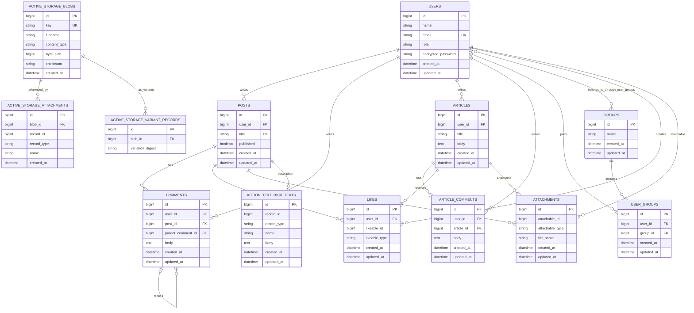

# Entity Relationship Diagram

This diagram is based on `app/models` and `db/schema.rb`.

Render this Mermaid diagram in GitHub, VS Code with Mermaid support, or the
[Mermaid Live Editor](https://mermaid.live/).

## Relationship notes

- `attachments.attachable` is polymorphic and can point to `Post`, `Article`, or `User`.
- `likes.likeable` is polymorphic and can point to `Post` or `Article`.
- `comments.parent_comment_id` creates the threaded, self-referencing comment relationship.
- `users` and `groups` have a many-to-many relationship through `user_groups`.
- `posts.description` is stored by Action Text in `action_text_rich_texts`.
- Active Storage tables are Rails infrastructure tables; they are included because they are present in the database schema.

## ERD symbol and relationship guide

### Entity and attribute symbols

- Each box represents a database table/entity.
- Fields inside a box represent table columns/attributes.
- `PK` means primary key, which uniquely identifies a record.
- `FK` means foreign key, which references a primary key in another table.
- `UK` means unique key/index, which prevents duplicate values.

### Cardinality symbols

Mermaid places a symbol at each end of a relationship line:

| Symbol | Meaning | Cardinality |
| --- | --- | --- |
| `\|\|` | Exactly one | 1 |
| `o\|` | Zero or one | 0..1 |
| `o{` | Zero or many | 0..* |
| `\|{` | One or many | 1..* |

For example, `USERS ||--o{ POSTS` means one user can have zero or many posts,
while every post belongs to exactly one user.

### Participation

- **Mandatory participation** is shown by `||`: the record must participate in exactly one relationship. For example, a post must have a user because `posts.user_id` is not nullable.
- **Optional participation** is shown by `o`: the record may participate in zero relationships. For example, a comment may have no parent comment because `parent_comment_id` is nullable.
- **Many participation** is shown by `{`: the record may be related to multiple records.
- A relationship such as `USERS }o--o{ GROUPS` represents optional many-to-many participation. The actual database connection is implemented through the `user_groups` join table.

### Polymorphic relationships

Polymorphic associations use an ID/type pair rather than a normal foreign key:

- `attachable_id` + `attachable_type` identify a `Post`, `Article`, or `User`.
- `likeable_id` + `likeable_type` identify a `Post` or `Article`.
- `record_id` + `record_type` identify the model that owns Action Text content.

These relationships are shown with multiple possible entity lines because the
database cannot enforce one fixed target table for a polymorphic association.
